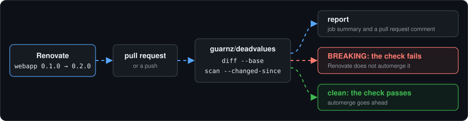

# GitHub Action

There are two actions in this repository:

| Action | What it does |
|---|---|
| `guarnz/deadvalues/setup@v0` | Installs the binary and adds it to the PATH. You write the commands |
| `guarnz/deadvalues@v0` | Runs deadvalues and writes the report to the job summary and a pull request comment. Either the built-in flow or your own command (`args`) |

Both download the release for the runner (Linux or macOS, amd64 or arm64) and verify it against `checksums.txt`. Check out with `fetch-depth: 0` so the base commit is available.

`setup` lives in a subdirectory of the same repository, like `actions/cache/restore`: both actions share the release tag and the install script, so `@v0` of one always matches `@v0` of the other. Only the root action is listed on the GitHub Marketplace.

## Setup only

```yaml
steps:
  - uses: actions/checkout@v7
    with:
      fetch-depth: 0
  - uses: guarnz/deadvalues/setup@v0
  - run: deadvalues scan apps -o sarif --output-file results.sarif --fail-on none
```

| Input | Default | Description |
|---|---|---|
| `version` | the action's ref | Release to install, e.g. `v0.1.0`, or `latest`; see [Versions](#versions) |
| `github-token` | `github.token` | Token used to download the release |

| Output | Description |
|---|---|
| `version` | The installed version |
| `path` | Path of the binary |

Nothing is written to the job summary and no comment is posted.

## Built-in flow



```yaml
on:
  pull_request:
  push:
    branches:
      - dev
permissions:
  contents: read
  pull-requests: write
jobs:
  deadvalues:
    runs-on: ubuntu-latest
    steps:
      - uses: actions/checkout@v7
        with:
          fetch-depth: 0
      - uses: guarnz/deadvalues@v0
        with:
          path: apps
```

The action compares the change that triggered the run with the state before it:

| Event | Base |
|---|---|
| `pull_request` | The pull request base: what the pull request changes |
| `push` | The commit before the push: what the push brought (every commit of it) |
| `base` input set | That ref or SHA |
| No base (first push of a branch, force push, `workflow_dispatch`, `schedule`) | None: every app is scanned, and the report says why |

What runs, by `mode`:

| `mode` | With a base | Without a base |
|---|---|---|
| `all` (default) | `diff --base` and `scan --changed-since` | `scan` of every app |
| `diff` | `diff --base` | Error: set `base` |
| `scan` | `scan --changed-since` | `scan` of every app |

`diff` catches what a chart bump does to your values (the Renovate case); `scan --changed-since` catches dead keys in the apps whose files changed.

To leave out apps that cannot render offline, list them in `skip`, by name or directory; both `diff` and `scan` get it:

```yaml
- uses: guarnz/deadvalues@v0
  with:
    path: kubernetes
    skip: cilium,kubernetes/apps/default/echo-server
```

## When the check fails

| Input | Fails the check on | Off |
|---|---|---|
| `fail-on-diff` | a chart bump at that level: `breaking` (default), `pinned` or `changed` | `none` or `false` |
| `fail-on-scan` | a key at that level: `dead`, `conditional` or `redundant` | `none` (default) or `false` |
| `fail-on-error` | an app that cannot be analyzed: a chart that does not render or cannot be downloaded (`true`, default) | `false` |

With `fail-on-error: false` the errors are still in the report and the comment, with a warning at the top, and the `status` output is still `2`. Findings at the fail-on levels still fail the check, and so does a command that fails as a whole (a wrong `path`, for instance). Telling the two apart needs `jq`, which GitHub-hosted runners have; on a self-hosted runner without it, errors fail the check as with `true`.

On a pull request, only the apps the change touches can fail the check: an app that already had an error before the change, and that the change does not touch, is left out of the report.

An app listed as not analyzed (a target deadvalues finds but does not support yet, such as a Helm chart from another git repository) is shown in the comment with its reason and never fails the check, whatever `fail-on-error` says.

To report without ever failing, for instance while trying the action on a repository:

```yaml
- uses: guarnz/deadvalues@v0
  with:
    fail-on-diff: false
    fail-on-error: false
```

To keep failing on breaking chart bumps but not on apps that cannot render in CI, such as a chart from a private registry:

```yaml
- uses: guarnz/deadvalues@v0
  with:
    fail-on-error: false
```

The comment then starts with:

```
> [!WARNING]
> Some apps could not be analyzed, see the errors below. This repository's workflow sets `fail-on-error: false`, so the check passes anyway.
```

## Your own command

```yaml
- uses: guarnz/deadvalues@v0
  with:
    args: diff --app apps/example.yaml --to 0.2.0
```

`args` replaces the built-in flow; `mode`, `base`, `skip` and the `fail-on-*` inputs are ignored, so put `--fail-on` in `args` if you need it. The value is split on spaces and quotes are not supported.

On a pull request, scan only what changed with `scan <dir> --changed-since <base>`, as the built-in flow does: a scan of every app downloads every chart and renders every key, which takes minutes on a large repository.

## Report

The job summary and the pull request comment show the findings of every command together, one section per app, and leave out apps with nothing to report:

````
## Deadvalues

> [!CAUTION]
> 1 breaking change: a chart upgrade stops reading a key you set. The check fails.

Summary:

```diff
Findings (1 app):
- example  1 breaking · 1 changed

Breaking:
- example  labels.team

Changed:
± example  revisionHistoryLimit
```

<details open><summary><b>example</b> (apps/example.yaml) · chart 0.1.0 → 0.2.0</summary>

| Finding | Key | Detail | Line |
|---|---|---|---|
| **BREAKING** | `labels.team` | ALIVE → DEAD | values.yaml:10 |
| CHANGED | `revisionHistoryLimit` | default 10 → 5 (you do not set it; the manifests change) | |
</details>

<details><summary>Commands</summary> … </details>

_Stats_: [Apps: 1], [Renders: 120], [Run: 1s], [Base: 0bc7546] · Run · Docs
````

- The summary starts with one line per app and its counts, then lists the keys from the most to the least severe: breaking, error, pinned, dead, changed, fixed, redundant, conditional. A key the `diff` reports is not repeated from the `scan`, and an error both report is shown once.
- The summary is a `diff` block, so GitHub colors it: an app line is red with a breaking change or an error, orange with a pinned or dead key, and green otherwise. A key line is red for breaking and error, orange for pinned and dead, green for fixed, and plain for the rest.
- An app section opens by default when it has a breaking change or an error. The Line column links to the file and line of the commit.
- A `CAUTION` alert appears only when the check fails; a `NOTE` when there was no base, so every app was scanned. Without findings the report says "No findings in the changed apps."
- The comment is posted only on pull requests, and updated on every push instead of adding a new one. On push the report is in the job summary.

The findings are read from the JSON output with `jq`, which GitHub-hosted runners have. A command without a JSON report, such as `explain` in `args`, is shown after the findings with its output, and a command that fails, with its errors. Without `jq`, every command is shown that way.

## Versions

The binary the actions install follows the ref you use them at, so pinning the action also pins deadvalues:

| `uses:` | Installs |
|---|---|
| `guarnz/deadvalues@v0.1.0` | v0.1.0 |
| `guarnz/deadvalues@v0` | the latest v0.x release; `v0` moves with every release |
| `guarnz/deadvalues@<commit SHA>` | the latest release |

The `version` input overrides it: an exact tag such as `v0.1.0`, or `latest`. Releases in `0.x` may change flags and outputs; pin an exact version or a SHA (Renovate keeps either up to date) if your workflow must not change on its own.

## Inputs

| Input | Default | Description |
|---|---|---|
| `path` | `.` | Directory with the Applications, HelmReleases or kustomize overlays. The default scans the whole repository |
| `mode` | `all` | `all`, `diff` or `scan` |
| `base` | from the event | Ref or SHA to compare with |
| `args` | | Run this command instead of the built-in flow |
| `skip` | | Apps or directories to leave out of the built-in flow, comma-separated: an app by its name, `namespace/name` or the name in the report |
| `fail-on-diff` | `breaking` | `breaking`, `pinned`, `changed`, `none` or `false` (the same as `none`) |
| `fail-on-scan` | `none` | `dead`, `conditional`, `redundant`, `none` or `false` (the same as `none`) |
| `fail-on-error` | `true` | `true` or `false`; with `false` an app that cannot be analyzed is reported but does not fail the check, see [When the check fails](#when-the-check-fails) |
| `comment` | `true` | Post or update the pull request comment |
| `version` | the action's ref | Release to install, e.g. `v0.1.0`, or `latest`; see [Versions](#versions) |
| `github-token` | `github.token` | Token to download the release and comment |

`fail-on-scan` is `none` by default because a scan also reports keys that were already dead before the change; set it to `dead` to fail on them too.

## Outputs

| Output | Description |
|---|---|
| `report` | Path of the Markdown report |
| `status` | `0` nothing at the fail-on levels, `1` findings, `2` errors (also with `fail-on-error: false`) |
| `base` | The base that was compared with, empty when there was none |
| `version` | The installed version |
